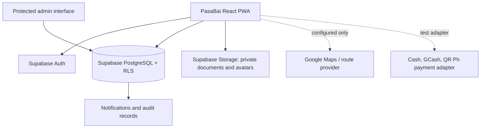
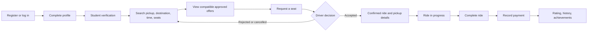
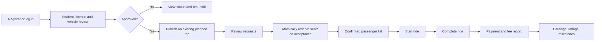
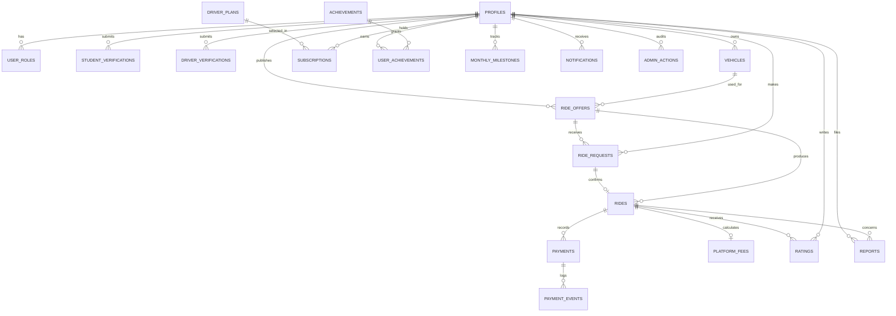

# PasaBai System Design

## Architecture

## Commuter Flow

## Driver Flow

## Database ERD

## State Rules

- Only approved drivers with an approved vehicle may publish a ride offer.
- A commuter may make one request per offer; database uniqueness enforces this.
- A driver accepts a request through `accept_ride_request`, which locks the offer, checks capacity, subtracts seats, marks the request accepted, and creates one ride in one transaction.
- Only a completed ride may create ratings, achievements, milestones, and finalized payment/fee records.
- Payment providers update provider-confirmed events server-side. The UI must never mark a real payment successful by itself.
- Admin approvals, suspensions, fee calculations, document access, and payment-provider callbacks require server-side privileged functions and audit records.

## Delivery Roadmap

1. Configure Supabase Auth, Storage, and the SQL schema.
2. Replace local demo state with a repository layer that chooses Supabase or explicit demo data.
3. Add commuter onboarding, search, offer details, requests, and ride lifecycle screens.
4. Add driver verification, vehicle management, trip publishing, request review, and earnings screens.
5. Add protected admin review workflows backed by server-side functions.
6. Add Maps, route matching, payment provider adapters, and notifications only when credentials and operational approvals are in place.
7. Add policy documents, consent, support/reporting, security monitoring, tests, and deployment review before public operation.
